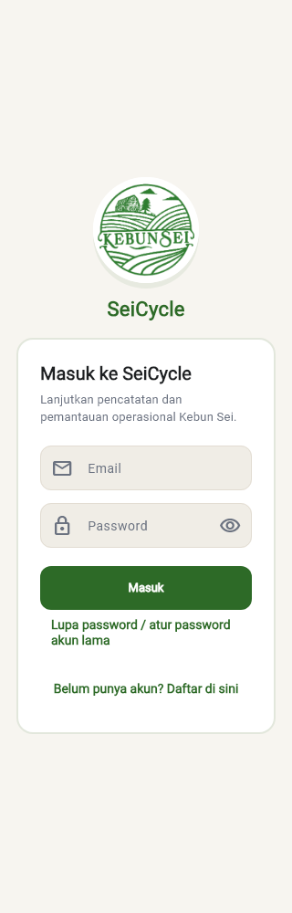

<div align="center">
  
  <h1>SeiCycle — Kebun Sei</h1>
  <p><strong>Smart Integrated Farming System</strong></p>
  <p>Operasional pertanian dan peternakan terintegrasi Kebun Sei, Pakisaji – Malang.</p>
</div>

## 🌿 Tentang proyek

SeiCycle adalah aplikasi Flutter untuk kegiatan, stok, produksi dan arus kas lima modul budidaya. Firebase Authentication menangani identitas; Cloud Firestore menyimpan data dengan Security Rules dan transaksi lintas dokumen. Ilustrasi siklus nutrisi menjelaskan konsep budidaya; transfer aktual dicatat tersendiri.

## Fitur utama

Empat tujuan utama: **Dashboard, Logbook, Edukasi, Notifikasi**. **Lainnya** membuka fitur tambahan di ponsel; sidebar tersedia mulai 768 px. Palet hijau/krem, logo dan istilah Indonesia dipertahankan. Data kosong, query gagal, hasil parsial dan nol ditampilkan sesuai maknanya. Aplikasi tidak membuat transaksi contoh atau menebak stok fisik dari ledger lama.

## Lima modul budidaya

| Modul | Catatan operasional |
| --- | --- |
| 🐔 Ayam Kampung | Populasi, pakan, telur, mortalitas dan kesehatan |
| 🐛 Maggot BSF | Limbah, fase, estimasi dan panen aktual |
| 🪱 Cacing Tanah | Media, kelembapan, pakan dan kascing |
| 🌿 Tanaman | Komoditas, blok, pertumbuhan, pemupukan dan panen |
| 🐟 Lele | Tebar, pakan, pH, suhu, bobot dan panen |

## Autentikasi

**Email/password**, registrasi, reset password, sesi dan logout. Google Sign-In sudah dihapus dari UI, layanan dan dependency. Reset memerlukan pengiriman email Firebase yang berfungsi. Akun baru memperoleh role operator lapangan; perubahan hak akses memakai workflow Admin tepercaya.

## Role dan izin

| Role | Kemampuan utama |
| --- | --- |
| `admin` aktif | Operasional, keuangan, Edukasi dan panel Admin sesuai batas integritas |
| `operator_lapangan` aktif | Tulis kegiatan, batch, inventaris, jadwal; laporan operasional |
| `operator_keuangan` aktif | Baca operasional, kelola finance manual, baca penjualan/laporan keuangan |
| `operator` | Alias operator lapangan |
| `mitra`, `peserta_edukasi` | Pembaca modul nonkeuangan |
| Inaktif / tanpa autentikasi | Ditolak dari data bisnis terlindungi |

UI, layanan dan Rules membatasi finance. Perubahan role/kehilangan akses membuang cache halaman, draft, detail dan dialog sesi sebelumnya. Pembaruan profil biasa mempertahankan draft. Penjualan baru dibatasi Admin aktif.

## Dashboard dan monitoring

KPI operasional, lima modul, timeline, stok rendah, batch dan arus kas sesuai role. Filter hari ini, 7/30/90 hari dan rentang khusus sampai 366 hari kalender lokal. Grafik memakai tanggal pengamatan nyata, unit terpisah dan tooltip; jeda tetap kosong. Batang padat dapat digeser. Estimasi berbeda dari produksi aktual; saldo stok berbeda dari panen. Refresh menampilkan waktu pembaruan dan batas cakupan.

## Logbook

Lima form, validasi numerik, batch opsional, simpan/retry dengan identitas permintaan, daftar/detail, filter dan pagination. Pencarian mencakup halaman termuat. Edit catatan tambahan memiliki audit. Koreksi kuantitas/pembatalan sumber melalui Admin memeriksa stok, produksi dan dependensi.

## Batch

Kode unik, siklus **direncanakan → aktif → selesai → arsip**, detail, riwayat dan tautan Logbook. Operator memakai batch aktif untuk catatan baru. Batch selesai/arsip menjadi baca-saja bagi operator; Admin tetap memeriksa dependensi.

## Inventaris dan jadwal

Master, saldo awal, stok masuk/keluar, koreksi fisik dan ledger dengan unit serta sumber. Ledger tanpa master tidak menciptakan saldo. Alur rekonsiliasi stok lama dipensiunkan.

Jadwal memiliki pending/done/skipped, checklist dan pengingat lokal. Sinkronisasi maksimal 50 jadwal pending dalam 14 hari. Edit mengganti pengingat; selesai/dilewati/hapus membatalkannya. Penolakan izin tidak membatalkan simpan. Waktu pengiriman mengikuti Android/OEM; recurrence otomatis belum tersedia.

## Keuangan dan penjualan

Pemasukan/pengeluaran manual, filter, audit dan **arus kas bersih**, bukan laba akuntansi. Penjualan menyimpan receipt, potongan stok, ledger dan pemasukan secara atomik. Quantity maksimal tiga desimal, harga/total integer Rupiah dengan pembulatan half-up. Pembatalan melalui worker membalik pasangan sumber; pemasukan sale tidak diubah terpisah.

Ringkasan dibatasi 500 transaksi; laporan maksimal 1.000 dokumen per sumber. Jika melebihi batas, persempit periode/filter. PDF/Excel mengikuti izin finance, menjaga unit dan memisahkan penjualan dari pemasukan agar tidak dihitung dua kali.

## Aliran nutrisi aktual

Material, jumlah/satuan, sumber/tujuan, tanggal, batch dan referensi kegiatan. Tidak otomatis mengubah stok. Ilustrasi Dashboard bukan transaksi. Data lama tanpa provenance diberi penjelasan ketidakpastian.

## Edukasi

Artikel, langkah SOP dan video HTTPS eksternal memiliki halaman detail. Admin menambah, mengedit, mengubah draft/terbit/arsip dan menghapus lunak dengan bukti edit atomik. Pembaca hanya melihat konten terbit. Filter modul/tipe/status, pencarian halaman termuat, fallback gambar dan pemuatan berikutnya tersedia. Tidak ada upload Firebase Storage.

Form mempertahankan input saat simpan gagal, mencegah klik ganda dan mempertahankan metadata saat edit. Form Edukasi biasa memakai transaksi Firestore yang diaudit. Kategori Edukasi pada panel Admin generik tetap membutuhkan worker.

## Notifikasi

Inbox Firestore, filter, baca/belum baca, retry dan tautan sumber. Broadcast memakai receipt khusus penerima; generasi baru kembali belum dibaca. Pengingat lokal terpisah dari inbox. FCM mencakup permission/token client; penjadwal push server belum tersedia.

## Rekomendasi operasional

Aturan untuk lima modul berdasarkan sumber aktual, dengan penjelasan data kurang dan sumber perhitungan. Tidak mengarang skor/panen. Rekomendasi finance mengikuti role; perubahan izin membuang cache sebelumnya.

## Pengelolaan data Admin

Panel mencakup **17 kategori bisnis**, termasuk jalur legacy. Preview, alasan, konfirmasi, hash keadaan, dependensi terbaru, receipt, audit dan backup melindungi koreksi/pembatalan/penghapusan. Identitas Auth memakai job terpisah dan UID tepat. Admin terakhir yang efektif dilindungi termasuk flag `is_active` lama.

**Full CRUD produksi belum diterima end-to-end:** host worker, IAM, monitoring dan UAT pemilik masih perlu diverifikasi. Bukti stok/sumber hilang, lebih dari 500 dokumen per root atau dependensi berbahaya membuat operasi ditolak. Tidak semua dokumen aman dihapus sembarang. Lihat [matriks keamanan dan kemampuan](docs/PHASE_08_SECURITY_AUDIT.md).

## Teknologi

| Lapisan | Baseline |
| --- | --- |
| Flutter / Dart | 3.44.2 / 3.12.2; lockfile mensyaratkan Flutter ≥3.44 dan Dart ≥3.12 |
| Data | Firebase Core, Authentication, Cloud Firestore, Messaging client |
| Grafik / pengingat | fl_chart, flutter_local_notifications, timezone |
| Ekspor | pdf, printing, excel, share_plus, path_provider |
| Worker | Node ≥22, firebase-admin 14.5.0, lockfile terpisah |
| Android | AGP 8.11.1, Gradle 8.14, Kotlin 2.2.20; bytecode Java 17 |

[Dependency Health](docs/DEPENDENCY_HEALTH.md) mencatat risiko maintenance `excel`, constraints `archive`/`image` dan transitif npm. Versi lebih baru tidak otomatis berarti deprecated. Tidak ada upgrade dependency massal.

## Arsitektur

```text
lib/app/                 Shell dan navigasi role
lib/core/                Komponen, validasi dan layanan bersama
lib/features/            Screen, model dan layanan per fitur
lib/theme/               Warna dan token desain
backend/admin/           Worker tepercaya dan identity outbox
test/                    Tes Flutter dengan fixture lokal
tools/firestore_tests/   Kontrak Rules di emulator
docs/                    Schema, audit, rollout dan handoff
```

## Konfigurasi Firebase

Project `seicycle-kebun-sei`, database `(default)` di `asia-southeast2`, package `id.seicycle.app`. Konfigurasi lokal `android/app/google-services.json` diabaikan Git. `lib/firebase_options.dart` dikonfigurasi hanya untuk Android; platform lain belum dinyatakan didukung.

Aktifkan email/password, gunakan konfigurasi FlutterFire yang berwenang dan jangan menaruh credential Admin pada client. Baca [schema](docs/FIRESTORE_SCHEMA.md), [Rules](firestore.rules), [indexes](firestore.indexes.json) dan [rollout](docs/PHASE_08_FIREBASE_DEPLOYMENT.md). Snapshot baca-saja Phase 08 menemukan Rules cocok dengan sumber serta **96 composite indexes READY**. Ulangi sebelum rollout; audit ini tidak men-deploy atau memutasi produksi.

## Menyiapkan worker Admin

```bash
npm ci --prefix backend/admin
```

Host tepercaya memerlukan Node ≥22, managed Application Default Credentials, project tepat, `SEICYCLE_ADMIN_WORKER_ENABLED=true`, supervisor/restart, monitoring dan pemilik recovery. Jalankan `node backend/admin/worker.mjs` setelah host/IAM/biaya disetujui. Firebase CLI login bukan otomatis ADC. Worker tidak berjalan di client.

## Pengembangan lokal

```bash
git clone https://github.com/Freddy47588/sei_cycle.git
cd sei_cycle
git switch feature/operational-v2
flutter pub get
flutter analyze
flutter run
```

Siapkan Flutter/Android SDK, Java kompatibel dan konfigurasi Firebase lokal. Penuhi lisensi yang diperlukan melalui `flutter doctor --android-licenses` setelah membacanya. Pengujian mutasi memakai emulator dengan project `demo-`.

## Build Android debug

```bash
flutter build apk --debug
```

`build/app/outputs/flutter-apk/app-debug.apk` adalah build pengujian lokal. Identitas/versi aktual ada di [laporan Android](docs/PHASE_08_ANDROID_RELEASE.md).

## Build Android release aman

Copy `android/key.properties.example` menjadi `android/key.properties` yang diabaikan Git, isi lokal; atau gunakan `SEICYCLE_STORE_FILE`, `SEICYCLE_STORE_PASSWORD`, `SEICYCLE_KEY_ALIAS`, `SEICYCLE_KEY_PASSWORD` dari penyimpanan rahasia. Path relatif dihitung dari `android/`. Jangan menaruh password dalam argumen/log.

```bash
flutter clean
flutter pub get
flutter analyze
flutter test --reporter expanded
flutter build apk --release
```

Tidak ada fallback debug key. Kredensial tidak lengkap, key debug dan sertifikat invalid ditolak. Output yang diharapkan `build/app/outputs/flutter-apk/app-release.apk` harus diverifikasi checksum, identitas dan sertifikatnya. [Panduan release](docs/PHASE_08_ANDROID_RELEASE.md) mencatat hasil aktual dan backup key. APK bukan otomatis rilis produksi.

## Pengujian

```bash
flutter pub outdated
flutter analyze
flutter test --reporter expanded
npm ci --prefix tools/firestore_tests
npm ci --prefix backend/admin
firebase emulators:exec --only firestore,auth --project demo-seicycle-admin07 --config firebase.phase07.json "npm --prefix backend/admin test"
firebase emulators:exec --only firestore --project demo-seicycle-admin07 --config firebase.phase07.json "node --test tools/firestore_tests/logbook_rules.test.mjs tools/firestore_tests/phase07_rules.test.mjs tools/firestore_tests/phase08_education_rules.test.mjs"
node --test tools/inventory_reconciliation.test.cjs
python -m unittest discover -s tools -p "test_*.py" -v
git diff --check
```

Emulator memerlukan Java/Node/Firebase CLI kompatibel dan loopback. Tool rekonsiliasi offline tidak mengaktifkan kembali UI lama. [Laporan tes](docs/PHASE_08_TEST_REPORT.md) memisahkan otomatis, emulator, perangkat dan yang belum diuji.

## Persyaratan deployment

Tinjau kompatibilitas client, Rules/indexes aktual, backup teruji, host/IAM, monitoring, signing dan UAT. Deployment Firebase serta billing memerlukan persetujuan pemilik. [Deployment](docs/PHASE_08_FIREBASE_DEPLOYMENT.md) memuat urutan, smoke test dan rollback.

## Batasan yang diketahui

- Android merupakan platform terkonfigurasi; file platform lain bukan bukti dukungan runtime.
- Worker produksi belum diterima; panel yang membutuhkannya dapat tertahan saat worker offline.
- Query, pencarian, graph dan ekspor memiliki batas eksplisit.
- Ledger tanpa master/provenance tidak jelas bukan saldo fisik terverifikasi. UAT 24 Oktober menemukan Rekomendasi tertahan oleh guard referensi historis; penerimaannya menunggu peninjauan sumber/backup yang sah.
- FCM server, recurrence, upload media dan jaminan pengingat tepat waktu belum tersedia.
- Semua role, perilaku OEM dan backup key tetap mengikuti penerimaan aktual.

## Tangkapan layar

Logo diperbesar pada ikon launcher, header, login dan Dashboard dengan mempertahankan gambar aslinya. Ikon adaptif menjaga logo di area aman agar tidak terpotong.




Gambar login adalah render layar implementasi dengan fixture lokal tanpa kredensial; bukan bukti login produksi. Screenshot prototipe pada `main` mengandung statistik contoh dan tidak menjadi bukti produksi. Render dan hasil perangkat dijelaskan di [laporan tes](docs/PHASE_08_TEST_REPORT.md). Screenshot berisi data bisnis/personal disimpan privat.

## Status proyek

Phase 01–07 diimplementasikan; Phase 08 memvalidasi regresi, perbaikan, signing dan penerimaan. **Produksi tetap bersyarat pada gate tercatat**, terutama worker dan UAT. Rujukan: [audit](docs/PHASE_08_FINAL_AUDIT.md), [release notes](docs/PHASE_08_RELEASE_NOTES.md), [UAT](docs/PHASE_08_UAT_CHECKLIST.md), [handoff](docs/PHASE_08_FINAL_HANDOFF.md).

## Kredit dan repository

Kebun Sei — Institut Teknologi dan Bisnis Asia Malang, Program P2MW 2025. Branding/rancangan awal SeiCycle dipertahankan. Pengembangan dan PR fase ini pada [Freddy47588/sei_cycle](https://github.com/Freddy47588/sei_cycle), dari `feature/operational-v2` ke `main` pada repository tersebut. Tidak push langsung ke `main` atau auto-merge PR.
